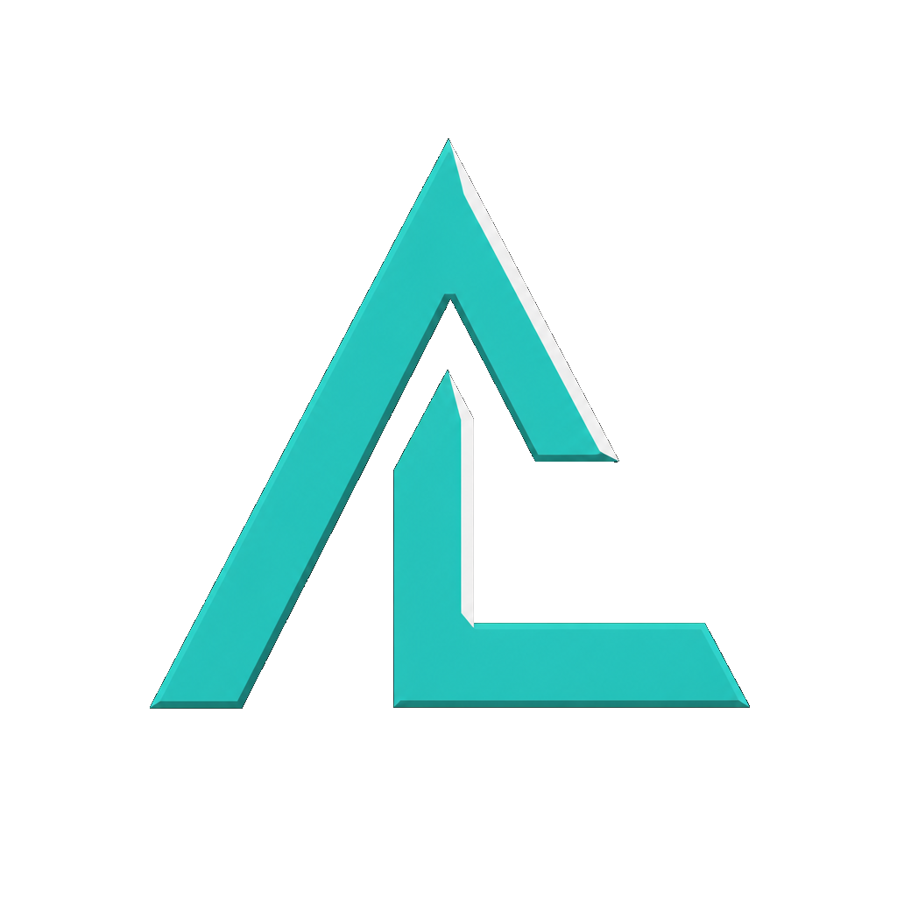
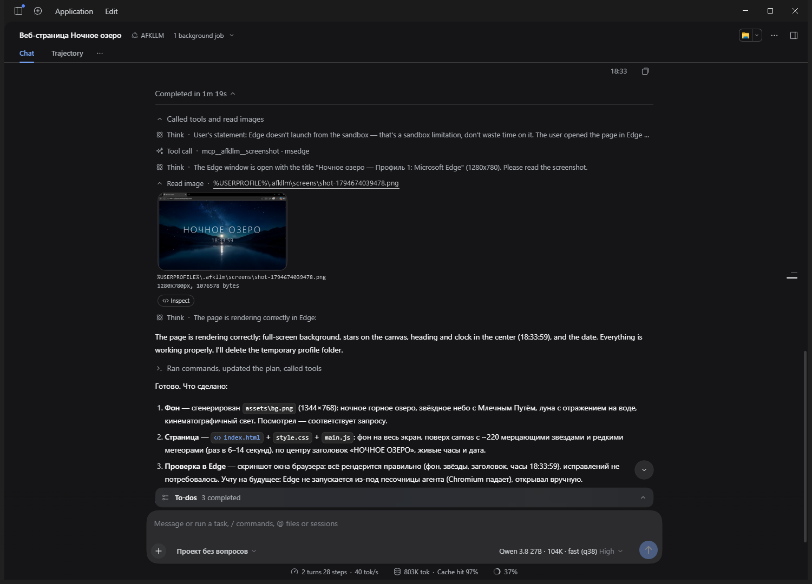
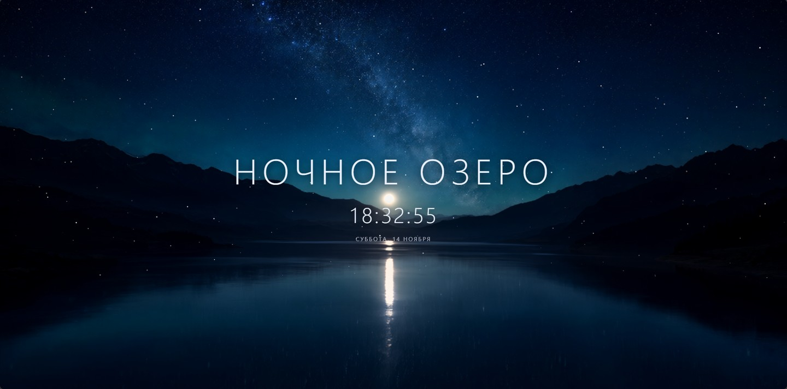
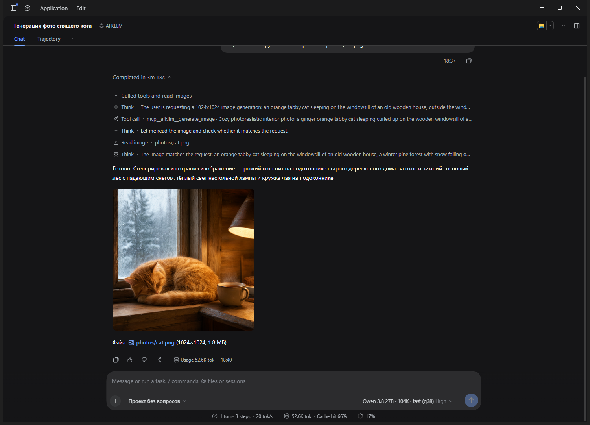
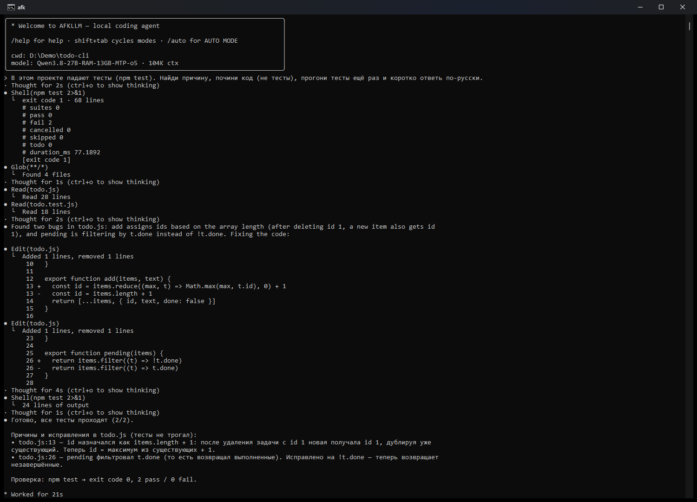
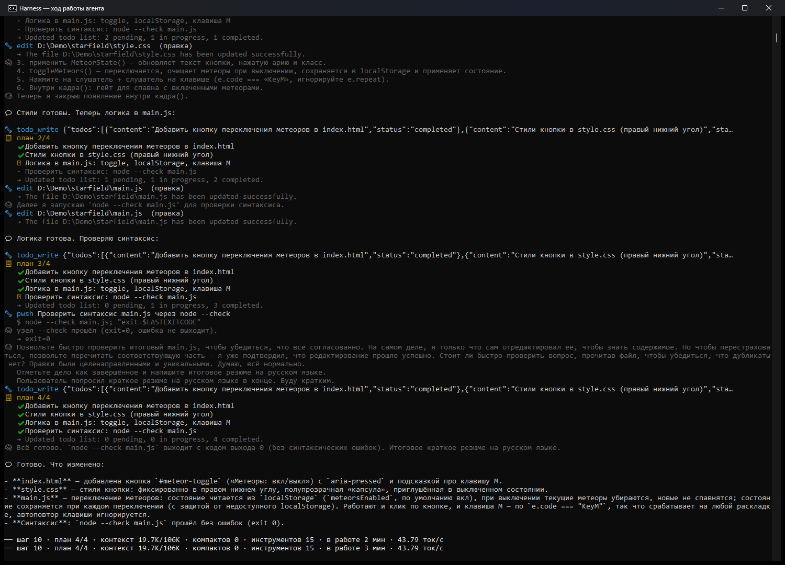
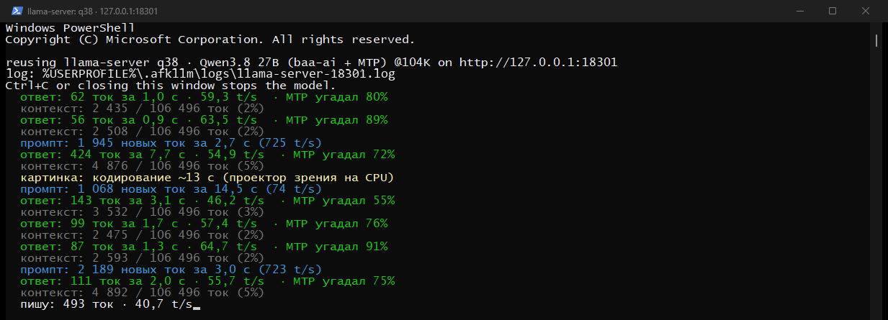

<div align="center">
  <a href="https://github.com/0xQ71/AFKLLM/releases">
    
  </a>
</div>

<p align="center">
  <a href="https://github.com/0xQ71/AFKLLM/releases">Релизы</a> |
  <a href="docs/cli.md">Документация</a> |
  <a href="https://github.com/0xQ71/AFKLLM/issues">Обратная связь</a>
</p>

<p align="center">
  <a href="https://github.com/0xQ71/AFKLLM/releases"></a>
  <a href="https://github.com/0xQ71/AFKLLM/actions/workflows/ci.yml"></a>
  <a href="https://github.com/0xQ71/AFKLLM/graphs/contributors"></a>
  <a href="LICENSE"></a>
  <a href="https://github.com/0xQ71/AFKLLM/stargazers"></a>
  <a href="https://github.com/0xQ71/AFKLLM/issues"></a>
  <a href="https://github.com/0xQ71/AFKLLM/network/members"></a>
</p>

---

<div align="center">

# AFKLLM

**Локальный ИИ-агент для кода на Windows**: модель, зрение, генерация картинок и веб-поиск на вашей видеокарте.

**Текущая версия: `0.5.0-20261123`.**

</div>

AFKLLM — это локальный бэкенд и агент для программирования. Он запускает языковую модель на вашей видеокарте (через
llama.cpp, а модели больше видеокарты — через [Strata](https://github.com/Niko1221/Strata), видеокарта + ОЗУ) и даёт
к ней три входа:

- **CLI `afk`**: агент в терминале в духе Claude Code. Читает и правит файлы, запускает команды, ведёт список дел,
  работает в режиме AUTO MODE часами без присмотра.
- **API `afk api`**: OpenAI-совместимый `/v1` плюс MCP-инструменты (генерация картинок, скриншоты, веб-поиск без
  ключей). К нему подключается любой клиент: [DeepSeek Harness](#3-deepseek-harness), opencode, ваш скрипт.
- **Desktop-приложение** (Electron) на том же ядре.

Модель, картинки, поиск и сессии остаются на вашем компьютере. Аккаунт, ключи и облако не нужны.

**Быстрый старт** (Windows, NVIDIA): установите [DeepSeek Harness](#3-deepseek-harness) и запустите его один раз, затем

```powershell
git clone https://github.com/0xQ71/AFKLLM.git; cd AFKLLM; npm install
scripts\setup.cmd
```

`setup` смотрит на железо и советует модель (64 ГБ ОЗУ → `flash`, 256K контекста; иначе `q38`), скачивает и
проверяет её, ставит движок, профиль Harness и ярлыки «AFKLLM — запустить / остановить модель / выключить всё» на
рабочий стол. Повторный запуск безопасен: готовые шаги пропускаются, оборванная загрузка докачивается.

👏 Отзывы и баги → [GitHub Issues](https://github.com/0xQ71/AFKLLM/issues) · подробная документация → [docs/cli.md](docs/cli.md)

❤️ Нравится AFKLLM? Поставьте звезду 🌟: так проект найдут те, кто ищет локальную замену облачным агентам.

---

# Скриншоты

<p align="center">
  
</p>

<p align="center">
  
</p>

<p align="center">
  
</p>

<p align="center">
  
</p>

<p align="center">
  
</p>

<p align="center">
  
</p>

---

# Возможности

1. **Агент для кода (CLI `afk`)**

- Инструменты: `Read`, `Write`, `Edit`, `Glob`, `Grep`, `Shell` (PowerShell, фоновые задачи для dev-серверов),
  `TodoWrite`, `Task` (подагент с чистым контекстом), `Screenshot`, `GenerateImage`
- Режимы прав: `default`, `acceptEdits`, `plan` и **AUTO MODE**. Даже в AUTO MODE опасные действия (запись вне
  проекта, `git push`, `reset --hard`, рекурсивное удаление широких путей, `curl | sh`) требуют подтверждения
- Мышление включено всегда, рассуждение передаётся между шагами (interleaved thinking): модель не теряет мысль
  между вызовами инструментов
- Стабильный системный промпт: KV-кэш переиспользуется на весь префикс. Сжатие контекста на 80 % в сводку плюс
  список дел
- Сессии сохраняются в `<проект>/.afkllm/sessions`, `afk -c` продолжает последнюю. Инструкции проекта берутся из
  `AFKLLM.md` или `AGENTS.md`
- Картинки в промпте: `@shot.png`, Ctrl+V скриншота из буфера, инструмент `Read` показывает модели `.png/.jpg/.webp`

2. **Бэкенд для внешних агентов (`afk api`)**

- `http://127.0.0.1:18300/v1`: OpenAI-совместимый чат. Прокси перед llama-server подставляет сэмплинг профиля,
  переводит `reasoning_effort` high/max в `xhigh`, конвертирует WebP в PNG и держит запросы, пока GPU занят картинкой
- Смена модели по полю `model` в запросе (имя профиля или путь к `.gguf`), `GET /v1/models` перечисляет профили
- `http://127.0.0.1:18300/mcp`: MCP (Streamable HTTP) с `generate_image`, `screenshot`, `web_search`
- `GET /search?q=…`: поиск без ключей по нескольким движкам (Yahoo, Bing, DuckDuckGo, Brave, Mojeek + Read the
  Docs, MDN, Stack Overflow, Wikipedia, GitHub) со слиянием выдачи
- `POST /translate/translatetext`: офлайн-переводчик (английский ↔ русский) в протоколе переводчика Edge. Переводит
  рассуждения в DeepSeek Harness и русские промпты `/image`. Модели OPUS-MT tc-big в CTranslate2 int8 работают на
  процессоре (2 потока, низший приоритет, видеокарта не нужна); код, пути и имена файлов не переводятся. Переводчик
  запускается при первом запросе и сам выключается через 15 минут простоя. Ставится один раз: `scripts\mt-setup.cmd`
- Модель живёт в отдельном окне `afk llama`: падение или перезапуск прокси не выгружает модель и её KV-кэш

3. **Генерация изображений**

- Qwen-Image 2.1 через ComfyUI, запускаемый только на время генерации. На 16 ГБ кодовая модель и модель картинок
  вместе не помещаются, поэтому хост меняет их местами: сохраняет KV-кэш LLM (0,6 с), выгружает её, рисует
  (~45–75 с на 1024²), возвращает LLM вместе с кэшем, и разговор не перечитывается
- Из PNG вырезаются метаданные (ComfyUI пишет туда промпт и весь граф), копия в папке ComfyUI удаляется
- В DeepSeek Harness есть `/image [ШxВ] [seed=N] промпт`: картинка прямо из промпта, без языковой модели и без
  записи промпта в лог сессии. Русский промпт сначала переводится на английский на этом ПК (Qwen-Image лучше
  понимает английский); английский вариант показывается в ответе команды и остаётся в чате, пока чат не удалён

4. **Зрение**

- Все профили грузят vision-проектор Qwen3.8 на CPU: весь контекст остаётся на GPU. Скриншот 1280×720 читается
  ~13 с и стоит ~920 токенов, генерация после этого ~65 t/s

5. **Приватность**

- Модель, сессии, картинки, перевод и поиск работают локально. Наружу уходят только поисковые запросы к
  поисковикам, см. [docs/cli.md](docs/cli.md)
- История ввода CLI хранится только в памяти окна (`/clear-history`), кэш поиска тоже только в памяти

---

# Рекомендуемая модель

Профили подобраны замерами на **RTX 5060 Ti 16 ГБ** (32 ГБ ОЗУ), мышление включено. Файлы ищутся в `C:\Models`
(другая папка задаётся переменной `AFK_MODELS_DIR`).

| Профиль | Модель | Контекст | Скорость и качество |
|---|---|---|---|
| **`q38`** (по умолчанию при ОЗУ < 64 ГБ) | Qwen3.8 27B (baa-ai RAM-13GB) + встроенный MTP + LM-голова Q5_K | 104K | **для 16 ГБ видеокарты**: coder-тест 16/16, агентные задачи 2/2, ~69 t/s на коротком ответе, ~40–50 t/s в реальной агентной работе, needle 6/6 на 90K; целиком на GPU |
| `q38-128k` | тот же файл, MTP draft 2, FFN 5 слоёв на CPU | 128K | ~46 t/s, на треть медленнее ради +24K |
| `q38-160k` | тот же файл без MTP | 160K | ~30 t/s (15 t/s на глубине 138K), для чтения очень больших входов |
| **`flash`** (по умолчанию при 64 ГБ ОЗУ) | Qwen3.8-Flash-Next IQ3_XXS (MoE, 47 ГБ весов) на [Strata](https://github.com/Niko1221/Strata) | **256K** (родной) | **рекомендуется, нужно 64 ГБ ОЗУ**: горячие эксперты в VRAM, остальные в ОЗУ на CPU; 55–85 t/s генерация (и на глубине 200K ~60), 750–1850 t/s чтение промпта (llama.cpp на этой модели: 18,5 и 300); needle 3/3 на 200K; мышление до 32K на шаг; агентная задача на 12 файлов и 23 теста в Harness за 7 мин |

Почему 104K, а не больше: модель умеет 262K, но упирается VRAM. С MTP каждый 1K контекста стоит ~29 МиБ, а
llama-server должен оставаться ниже ~15,5 ГБ: дальше Windows молча уносит память в ОЗУ, и скорость падает до
6–40 t/s. KV-кэш q4_0 качество почти не трогает (KLD 0,006 против f16; KV есть только у 16 из 64 слоёв).

**Как собрать файл модели** (байты тензоров копируются, ничего не переквантуется):

1. Скачайте в `C:\Models\baa-ai__Qwen3.8-27B-RAM-13GB-GGUF\`:
   - [`Qwen3.8-27B-RAM-13GB.gguf`](https://huggingface.co/baa-ai/Qwen3.8-27B-RAM-13GB-GGUF) (12,6 ГБ), основная модель
   - из [`unsloth/Qwen3.8-27B-GGUF`](https://huggingface.co/unsloth/Qwen3.8-27B-GGUF): `MTP/mtp-Qwen3.8-27B-Q4_0.gguf`
     (MTP-голова), `Qwen3.8-27B-UD-Q3_K_XL.gguf` (донор LM-головы Q5_K, после склейки можно удалить) и
     `mmproj-BF16.gguf` (зрение), переименуйте его в `mmproj-Qwen3.8-27B-BF16.gguf`
2. Склейте:
   ```powershell
   python -u scripts/stage0/graft-mtp.py Qwen3.8-27B-RAM-13GB.gguf mtp-Qwen3.8-27B-Q4_0.gguf `
     Qwen3.8-27B-RAM-13GB-MTP-o5.gguf --output-from Qwen3.8-27B-UD-Q3_K_XL.gguf
   ```
3. llama.cpp **b12063** (CUDA 13.4) в `C:\Models\llama.cpp\b12063\`. Его и всё для картинок скачивает
   `python -u scripts/stage0/download-models.py --root C:\Models`. Более новая b12329 на этом профиле оказалась на
   12–23 % медленнее (ниже принятие MTP), поэтому закреплена b12063.

**Профиль `flash` (Strata)** — модель больше видеокарты, основная на ПК с 64 ГБ ОЗУ. Всё ниже делает
`scripts\setup.cmd -Model flash`; вручную:

1. ОЗУ 64 ГБ и файл подкачки так, чтобы ОЗУ + подкачка было не меньше ~96 ГБ (Strata резервирует ~61 ГБ; при
   меньшем лимите она сама выключает кэш разговоров). Видеокарта NVIDIA от 12 ГБ.
2. Файлы модели (~72 ГБ) в `C:\Models\ISTA-DASLab__Qwen3.8-Flash-Next-GSQ-RCO-GGUF\IQ3_XXS\`:

   | Файл | Размер | Что |
   |---|---|---|
   | [`Qwen3.8-Flash-Next-GSQ-RCO-IQ3_XXS-00001-of-00002.gguf`](https://huggingface.co/ISTA-DASLab/Qwen3.8-Flash-Next-GSQ-RCO-GGUF/resolve/main/IQ3_XXS/Qwen3.8-Flash-Next-GSQ-RCO-IQ3_XXS-00001-of-00002.gguf) | 43,8 ГБ | веса |
   | [`Qwen3.8-Flash-Next-GSQ-RCO-IQ3_XXS-00002-of-00002.gguf`](https://huggingface.co/ISTA-DASLab/Qwen3.8-Flash-Next-GSQ-RCO-GGUF/resolve/main/IQ3_XXS/Qwen3.8-Flash-Next-GSQ-RCO-IQ3_XXS-00002-of-00002.gguf) | 26,8 ГБ | таблица n-грамм |
   | [`mmproj-Qwen3.8-Flash-Next-BF16.gguf`](https://huggingface.co/ISTA-DASLab/Qwen3.8-Flash-Next-GSQ-RCO-GGUF/resolve/main/mmproj-Qwen3.8-Flash-Next-BF16.gguf) | 0,9 ГБ | зрение |

   Удобнее загрузчиком (8 потоков, докачка, проверка SHA-256; уже скачанные файлы только проверяет):
   `python -u scripts/stage0/download-models.py --flash`
3. [Strata Terminal](https://github.com/Niko1221/Strata) (MIT; ставится в `%LOCALAPPDATA%\Strata`, без прав
   администратора, PATH не трогает): `irm https://github.com/Niko1221/Strata/releases/latest/download/install.ps1 | iex`.
   Затем один раз `scripts\strata-setup.cmd`: подготовка модели на месте (+1,7 ГБ), загрузка движка и драфтера
   DFlash2, подбор настроек, пресет `afk-flash`.
4. `scripts\harness.cmd` (или `afk api`): при 64 ГБ ОЗУ и готовой Strata профиль `flash` выбирается сам. Загрузка
   ~60–80 с. AFKLLM запускает сервер Strata на порту 18301 вместо llama-server, поэтому прокси, смена модели и
   GPU-своп для картинок работают как обычно. Проверки обновлений Strata выключены (`STRATA_UPDATE_CHECK=0`).

Своя модель или другая видеокарта: добавьте профиль в `~/.afkllm/cli.json` (см. [Своё использование](#4-своё-использование)).

---

# Установка

Установщики для **Windows x64** лежат на странице [Releases](https://github.com/0xQ71/AFKLLM/releases):

| Файл | Что это |
|------|---------|
| `afk.exe` | CLI и бэкенд одним файлом: `afk`, `afk api`, `afk llama`, `afk models`, `afk serve`. Node.js не нужен |
| `AFKLLM-0.5.0-20261123-x64-setup.exe` | Desktop-приложение (NSIS: папка установки, ярлыки, меню «Пуск») |

Модели, llama.cpp и ComfyUI в установщики не входят:

- **Модель**: см. [Рекомендуемая модель](#рекомендуемая-модель)
- **llama-server**: `C:\Models\llama.cpp\b12063\llama-server.exe`, или путь в `AFK_LLAMA_SERVER`, или
  `"llamaServer"` в `~/.afkllm/cli.json`
- **Картинки** (необязательно): ComfyUI portable в `C:\ComfyUI\ComfyUI_windows_portable` (или `AFK_COMFY_DIR`) с
  узлом [ComfyUI-GGUF](https://github.com/city96/ComfyUI-GGUF) и веса Qwen-Image 2.1 в
  `C:\Models\Qwen-Image-2.1\{diffusion_models,text_encoders,vae}`: `qwen-image-2.1-UC-Q8_0.gguf`,
  `qwen3vl_8b_w4a8.safetensors`, `qwen_image_2.1_vae_bf16.safetensors`. Всё это ставит
  `scripts/stage0/download-models.py`. Без них работает всё, кроме генерации картинок (`AFK_IMAGEGEN=0` отключает
  её явно)

Из исходников:

```powershell
git clone https://github.com/0xQ71/AFKLLM.git
cd AFKLLM
npm install
scripts\afk.cmd --help          # CLI без сборки (tsx)
npm run build:cli               # release\cli\afk.exe
npm run dist                    # release\AFKLLM-<версия>-x64-setup.exe
```

---

# Как пользоваться

## 1. CLI

```powershell
afk                                   # интерактивная сессия в текущей папке
afk "почини падающий тест"            # сразу с задачей
afk --auto                            # AUTO MODE: работает сам, опасное всё равно спросит
afk -p "что делает src/core/agent.ts?"          # один ответ и выход (print mode)
Get-Content task.md | afk -p --auto             # многострочная задача через stdin
afk -c                                # продолжить последнюю сессию в этой папке
afk -m q38-160k                       # другой профиль модели
afk --url http://127.0.0.1:8080       # уже запущенный llama-server
```

Из исходников вместо `afk` используйте `scripts\afk.cmd` (или `npm run afk -- …`).

**Команды:**

| Команда | Что делает |
|---|---|
| `afk [prompt]` | интерактивный агент |
| `afk api [--lan]` | бэкенд для внешнего агента: `/v1`, `/mcp`, `/search` на 127.0.0.1:18300 |
| `afk llama [-m профиль]` | только llama-server на порту 18301, пока окно открыто; `afk api` его подхватит |
| `afk models [--json]` | список профилей моделей |
| `afk serve --stdio` | headless-протокол NDJSON (для своих интерфейсов) |

**Опции:** `-p/--print`, `--auto`, `--mode <default|acceptEdits|plan|auto>`, `-m/--model <профиль|.gguf>`,
`--url <url>`, `--ctx <n>`, `--port <n>` (по умолчанию 18300), `-c/--continue`, `-r/--resume [id]`,
`--output-format <text|stream-json>`, `-v/--verbose` (мышление и текст в stderr в print mode), `--max-turns <n>`,
`--keep-server` (не останавливать llama-server при выходе), `--lan`, `--cwd <папка>`, `-h/--help`.

**Команды в сессии:** `/help`, `/mode [имя]`, `/auto`, `/plan`, `/todos`, `/compact [фокус]`, `/clear`,
`/clear-history`, `/sessions`, `/resume [id]`, `/status`, `/theme [black|default]`, `/exit`.

**Клавиши:** `shift+tab` переключает режим · `esc` прерывает агента · `enter` во время работы ставит сообщение в
очередь · `\`+`enter` или `alt+enter` даёт новую строку · `ctrl+o` показывает мышление · `ctrl+t` показывает
список дел · `ctrl+v` вставляет текст или скриншот · `ctrl+c` дважды выходит.

| Режим | Правки | Команды |
|---|---|---|
| `default` | спрашивает | спрашивает |
| `acceptEdits` | сам | спрашивает |
| `plan` | нельзя: изучает и предлагает план | нельзя |
| `auto` (**AUTO MODE**) | сам | сам (кроме опасных) |

`afk` работает в папке, из которой запущен. Чтение и запись вне её всегда спрашивают. Запуск в опасном месте (корень
диска, профиль пользователя, Рабочий стол, Загрузки, Windows, Program Files) сначала переспросит.

## 2. API

```powershell
afk api                 # 127.0.0.1:18300; модель грузится в фоне
afk api -m q38-128k     # другой профиль
afk api --lan           # /v1 доступен с других ПК в сети (/mcp всегда только локально)
```

| Адрес | Что |
|---|---|
| `POST /v1/chat/completions` | OpenAI-совместимый чат (стриминг, инструменты, картинки, `reasoning_content`) |
| `GET /v1/models` | профили, загруженный помечен |
| `POST /mcp` | MCP: `generate_image(prompt, file_path, width, height, negative_prompt, seed)`, `screenshot(window_title \| process_name)`, `web_search(query, limit, allowed_domains, blocked_domains, recency)` |
| `GET /search?q=…&limit=8` | веб-поиск, JSON: `sources`, `engines`, `failed` |
| `GET /health` | жив ли прокси |

Ключ не нужен: если клиент требует, подойдёт любая строка.

```python
from openai import OpenAI
client = OpenAI(base_url="http://127.0.0.1:18300/v1", api_key="local")
r = client.chat.completions.create(
    model="q38",                       # имя профиля; другое имя перезагрузит модель (~10–20 с)
    messages=[{"role": "user", "content": "Напиши функцию слияния двух отсортированных списков на Python"}],
)
print(r.choices[0].message.content)
```

```powershell
curl http://127.0.0.1:18300/v1/chat/completions -H "Content-Type: application/json" `
  -d '{"model":"q38","messages":[{"role":"user","content":"Привет"}]}'
```

MCP подключается к любому клиенту с Streamable HTTP: `http://127.0.0.1:18300/mcp`. Параметры адреса:
`?exclude=web_search` скрывает инструмент, `&images=path` возвращает путь к картинке вместо самой картинки.

## 3. DeepSeek Harness

DeepSeek Harness (Desktop-приложение DeepSeek для агентной работы) даёт агентный цикл и интерфейс (сессии, план, подагенты, сжатие
контекста, навыки), а AFKLLM даёт модель, зрение, картинки и поиск.

**Один раз:**

1. Установите DeepSeek Harness Desktop и запустите его один раз: он создаст профиль `desktop`.
2. Поставьте профиль AFKLLM:
   ```powershell
   powershell -ExecutionPolicy Bypass -File harness\install-profile.ps1
   ```
   Скрипт сохраняет старый `cordis.patch.yml` как `.bak-<дата>` и кладёт [`harness/dsh-profile/cordis.patch.yml`](harness/dsh-profile/cordis.patch.yml):
   провайдер `afkllm` (модели `q38`, `q38-128k`, `q38-160k`, `flash`), пресеты **AFKLLM** и **AFKLLM + браузер**
   (Playwright MCP на Edge), сжатие под окно 104K, MCP-инструменты AFKLLM и Context7, режим прав `workspace-auto`,
   выключенная телеметрия. Ещё он подключает плагины поиска, `/image` и хуков из этого репозитория, кладёт правила агента
   `AGENTS.md` и навыки (`init`, `review`, `security-review`, `test`, `debug`, `commit`, `remember`, `simplify`, `browser-test`, `godot`) в
   `~/.dsh` (существующие не трогает) и задаёт `AFKLLM_API_KEY=local`. Проверяет, что профиль собирается.

**Каждый раз:**

```powershell
scripts\harness.cmd             # модель по умолчанию (flash при 64 ГБ ОЗУ, иначе q38) + прокси + Harness
scripts\harness.cmd -Ask        # спросить, какую модель грузить
scripts\harness.cmd -Model q38-128k
scripts\harness.cmd -Watch      # ещё окно harness-watch: что делает агент
scripts\harness.cmd -NoHarness  # только модель и прокси
scripts\afk-stop.cmd            # остановить всё (модель, прокси, Harness) и освободить VRAM; -KeepHarness оставит Harness
```

Откроются окна **llama-server** (модель и её живая работа на русском: чтение промпта в %, скорость, принятие MTP,
заполнение контекста, кодирование картинок) и **AFKLLM: прокси** (`afk api`). Окно модели ею владеет: закроете его,
и модель остановится. Прокси можно перезапускать сколько угодно, модель и KV-кэш остаются.

В Harness:

- выбор модели в списке перезагружает llama с нужным профилем;
- `web_search` показывает карточку поиска (сколько результатов, с каких движков, источники);
- `/permission workspace-auto`: правки и команды без подтверждений, но только внутри проекта;
- браузер: Edge/Chromium из песочницы Harness не запускается (падает на старте), поэтому для веб-проектов есть пресет
  **AFKLLM + браузер** (Playwright MCP работает вне песочницы); без него агент проверяет страницу скриншотом окна,
  которое вы открыли сами;
- `/image 1344x768 seed=7 ночное озеро в горах`: картинка без языковой модели, сохраняется в
  `~/.afkllm/private-images` (у каждого чата своя папка); `/image-clean` удаляет картинки этого чата вместе с их
  копиями ComfyUI и ярлыками «Недавние», картинки других чатов не трогает; `/image-clean all` чистит всё;
- раскрытый блок мыслей показывается по-русски через офлайн-переводчик (`scripts\mt-setup.cmd` один раз), кнопка
  «оригинал» возвращает английский текст. Переводы чата Harness хранит внутри этого чата и удаляет вместе с ним.

**Хуки как в Claude Code** (плагин [`harness/dsh-hooks-afkllm`](harness/dsh-hooks-afkllm/index.js), `/hooks` показывает
состояние и последние срабатывания):

- **защита**: команды, которые ломают ПК (удаление диска или профиля, форматирование, diskpart, перезагрузка,
  отключение Defender), запрещены; перед `git push --force`, `reset --hard`, `clean -f`, `branch -D` и «скачать и
  выполнить» (`irm | iex`, `curl | sh`) Harness спрашивает;
- **проверка после каждой правки**: синтаксис Python, JS, TypeScript (через `typescript` проекта), JSON, PowerShell и
  забытые маркеры конфликта; ошибки попадают в результат инструмента, и модель чинит их сразу, а не через десять шагов;
- **проверка перед концом хода**: если правленый файл всё ещё сломан или не прошёл Stop-хук проекта (например,
  тесты), агент получает причину и продолжает работу (не больше 3 раз за ход);
- **уведомление Windows**, когда ход шёл дольше минуты: можно уйти от ПК;
- **свои хуки** в формате Claude Code: `~/.dsh/hooks.json` и `<проект>/.dsh/hooks.json` (`PreToolUse`, `PostToolUse`,
  `Stop`; JSON события на stdin, код 2 = блок). Файл проекта запускается только после `/hooks trust` и снова требует
  его после любого изменения: агент не может сам себе написать хук.

  ```json
  { "hooks": { "Stop": [ { "hooks": [ { "type": "command", "command": "npm test 1>&2 || exit /b 2", "timeout": 600 } ] } ] } }
  ```

`node scripts/harness-watch.mjs [проект|id-сессии]` в отдельном окне показывает живой ход сессии: рассуждения
модели (на русском через офлайн-переводчик `afk api`, `--en` показывает оригинал), вызовы инструментов, план и оценку
времени, контекст, сжатия, скорость.

Подробности (что уходит в сеть, размер картинок для CPU-проектора, переключение моделей) есть в
[docs/cli.md](docs/cli.md#backend-for-an-agent-harness-afk-api).

## 4. Своё использование

**Свои профили моделей**, `~/.afkllm/cli.json`:

```json
{
  "defaultProfile": "mine",
  "llamaServer": "D:\\llama.cpp\\llama-server.exe",
  "profiles": {
    "mine": {
      "model": "D:\\Models\\my-coder-Q4_K_M.gguf",
      "ctx": 65536,
      "args": { "n-gpu-layers": "99", "cache-type-k": "q8_0", "cache-type-v": "q8_0" },
      "sampling": { "temperature": 0.6, "top_p": 0.95 }
    },
    "q38": { "ctx": 98304 }
  }
}
```

`args` — это флаги llama-server без `--` (`null` означает флаг без значения). Профиль с именем встроенного (`q38`)
меняет только указанные поля. `afk models` покажет, что получилось.

**Переменные окружения:** `AFK_MODELS_DIR` (папка моделей, по умолчанию `C:\Models`), `AFK_LLAMA_SERVER`,
`AFK_MODEL` (профиль по умолчанию), `AFK_COMFY_DIR`, `AFK_IMAGEGEN=0` (без картинок), `AFK_VISION=1` (модель видит
картинки при `--url`: профиль неизвестен, поэтому CLI иначе считает, что зрения нет),
`AFK_ALLOW_FOLDER=1` (разрешить `-p`/`serve` в «опасной» папке), `AFK_THEME` (`black`|`default`).

**Свой интерфейс поверх агента**: `afk serve --stdio` принимает и отдаёт по одному JSON на строку.
Вход: `{"type":"run","text":"…"}`, `{"type":"abort"}`, `{"type":"mode","mode":"auto"}`,
`{"type":"permission_response","id":1,"allow":true,"remember":false}`, `{"type":"compact"}`, `{"type":"clear"}`,
`{"type":"state"}`, `{"type":"exit"}`. Выход: `ready`, все `AgentEvent` из [`src/core/types.ts`](src/core/types.ts),
`permission_request`, `idle`. На этом протоколе сделано Desktop-приложение.

**Скрипты и CI:** `afk -p --output-format stream-json --auto "задача"` печатает события агента построчно.

**Другие агенты** (opencode, Cline, Continue, свой цикл): base URL `http://127.0.0.1:18300/v1`, модель `q38`,
MCP `http://127.0.0.1:18300/mcp`.

## 5. Desktop-приложение

`AFKLLM-…-setup.exe` ставит приложение на том же ядре: сессии слева, лента агента со свёрнутыми вызовами
инструментов и «Thought for Ns», карточки разрешений, выбор папки, режима и модели, кольцо контекста; справа
панели Терминал, Изменения, Браузер. При закрытии с загруженной моделью оно предложит её выгрузить. Старый
интерфейс 0.3 доступен по кнопке «Classic UI».

---

# Тесты и бенчмарки

```powershell
npm run typecheck        # tsc: main, renderer, cli
npm test                 # юнит-тесты определения стека проекта (scripts/stack-detect.test.ts)
npm run test:core        # ядро: инструменты, права, цикл агента, сжатие, защита от петель, прокси, MCP, поиск (scripts/core.test.ts)
```

CI на GitHub гоняет `typecheck` и `npm test` на каждый пуш, релизный workflow собирает установщик и `afk.exe` по тегу `v*`.

Бенчмарки моделей (по ним выбраны профили), `scripts/stage0/`:

| Скрипт | Что меряет |
|---|---|
| `bench.py --profile <p> [--ctx N] [--tests …]` | скорость генерации и prefill, повторное использование кэша, надёжность tool calls, заполнение контекста, needle (6 фактов на глубине 5–95 % из ~100K) |
| `coder-eval/eval_coder.py` | 16 задач на код со скрытыми тестами |
| `agent-task/run_agent_task.py` | агентные задачи: найти баг (T3), добавить фичу (T2) |
| `speed-agent.ts` | скорость на реальной агентной работе (12K кода, рассуждение по-русски) |
| `mtp-ab.py`, `mtp-tie.py` | вредит ли MTP качеству (A/B на жадной генерации) |
| `run-bench.ps1` | очередь бенчмарков в видимом окне с логом |

Результаты пишутся в `C:\Models\_bench`.

---

# Дорожная карта

1. **Агент**: diff-ревью правок агента (принять или отклонить до записи), `@file`/`@selection` в CLI, git worktree
   для параллельных задач
2. **Модели**: замеры новых 27–35B и MoE-моделей на 16 ГБ, автоматический подбор профиля под видеокарту
3. **Desktop**: перенос на Tauri 2 с ядром в Node-сайдкаре, панель файлов, комментарии к diff
4. **Упаковка**: подписанные установщики (SignPath), установщик моделей одной кнопкой

Хотите повлиять на дорожную карту? Откройте [Feature request](https://github.com/0xQ71/AFKLLM/issues/new/choose).

---

# Участие

Мы рады любой помощи:

1. **Код**: ядро агента, CLI, прокси, профили моделей
2. **Баги**: воспроизведите, сузьте и пришлите небольшой PR
3. **Замеры**: прогоните `scripts/stage0` на своей видеокарте и поделитесь результатами
4. **Документация**: README, гайды, переводы

Подробнее в [CONTRIBUTING.md](CONTRIBUTING.md). Перед PR запустите `npm run typecheck`, `npm test` и
`npm run test:core`.

---

# Связанные проекты

- [llama.cpp](https://github.com/ggml-org/llama.cpp): инференс (`llama-server`)
- DeepSeek Harness: агентный интерфейс поверх `afk api`
- [ComfyUI](https://github.com/comfyanonymous/ComfyUI) и [ComfyUI-GGUF](https://github.com/city96/ComfyUI-GGUF): генерация изображений
- [Model Context Protocol](https://modelcontextprotocol.io/): инструменты для агентов
- [Electron](https://github.com/electron/electron) и [Monaco Editor](https://github.com/microsoft/monaco-editor): Desktop-приложение

---

# Авторы

<a href="https://github.com/0xQ71/AFKLLM/graphs/contributors">
  
</a>

---

# Статистика GitHub


---

# История звёзд

<a href="https://www.star-history.com/#0xQ71/AFKLLM&Date">
  <picture>
    <source media="(prefers-color-scheme: dark)" srcset="https://api.star-history.com/svg?repos=0xQ71/AFKLLM&type=Date&theme=dark" />
    <source media="(prefers-color-scheme: light)" srcset="https://api.star-history.com/svg?repos=0xQ71/AFKLLM&type=Date" />
    
  </picture>
</a>

---

# Лицензия

AFKLLM распространяется по лицензии **MIT**, см. [LICENSE](LICENSE).

- Атрибуция: [NOTICE](NOTICE)
- Лицензии сторонних зависимостей: [THIRD_PARTY_NOTICES.md](THIRD_PARTY_NOTICES.md)
  (обновляются командой `npm run licenses:third-party`)

Copyright © 2026 [0xQ71](https://github.com/0xQ71).

> **Примечание:** AFKLLM разрабатывается с использованием современных AI-инструментов для ускорения разработки. Автор отвечает за всю архитектуру и финальные инженерные решения.
